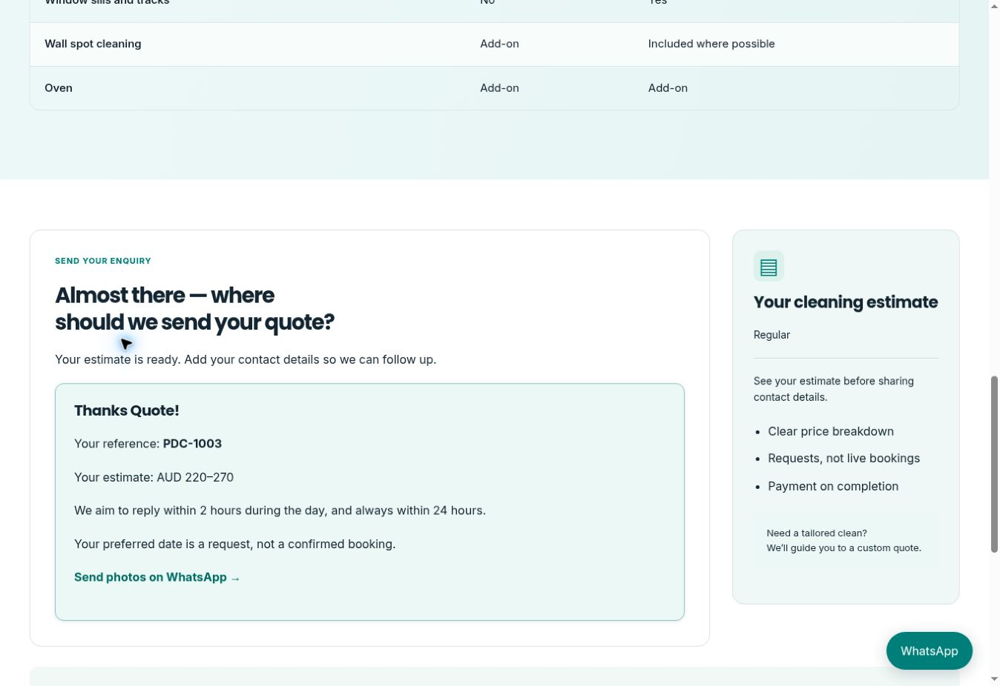

> **Superseded:** this Free/custom-calculator bridge does not meet the no-custom-code contract. Do not use it for handover. See [native migration status and blockers](native-migration/README.md).

# Fluent Forms and visual editing

Branch: `feature/prime-fluent-forms-builder`, based on main `a10970d`.

This branch connects **Fluent Forms Free 6.x** to the existing Contact page and the enquiry step after the estimator. It preserves the approved page design and price engine. This is not a zero-custom-code rebuild, and it does not deploy or activate anything on a hosted WordPress installation automatically.

## Install on the review WordPress site

1. Back up the database and `wp-content`. Update the existing `kadence-child` theme and `prime-cleaning-estimator` plugin from this branch. Do not import `database.sql`.
2. Install and activate **Fluent Forms** from the official WordPress plugin directory. The free edition is enough for this integration. Keep Prime Estimator activated.
3. Open **Settings → Prime Fluent Forms** and click **Create missing forms and enable Fluent Forms**. It records the actual Contact and Quote enquiry form IDs, without overwriting existing forms or page bodies. Repeating setup does not duplicate forms.
4. Edit labels, field layout and help text through the linked Fluent Forms visual editors. Retain existing field names, required fields and hidden integration fields. The enquiry suburb is filled from the estimate and read-only; use Back to change it.
5. Test Contact and the final enquiry step on Prices. New entries appear in Fluent Forms and the existing Prime Estimator workflow. Keep using Prime Estimator for New/Contacted/Won/Lost, frozen prices, CSV exports and email handoff status. The same `PDC-…` reference is recorded in Fluent Forms submission metadata.
6. Verify the approved sender, recipient and SMTP settings under Prime Estimator before real delivery tests. Existing Prime notifications send once; the generated Fluent Forms notification list is empty to avoid duplicate emails. A saved enquiry is not a delivery guarantee or confirmed booking.

**Rollback:** click **Use original forms (rollback)** on the same settings page. The saved Fluent Forms definitions and submissions remain. Missing/deactivated Fluent Forms or an unpublished configured form also falls back to the original form for that surface.

## What the website builder can replace

| Part | Current editing approach | Custom code still required here |
| --- | --- | --- |
| Page text, headings, images, buttons, cards, FAQs | WordPress block editor; Kadence Blocks is already installed | Existing CSS keeps precise styling |
| Contact and quote-enquiry fields | Fluent Forms visual editor | A scoped CSS adapter and quote handoff |
| Header, footer and navigation | Existing shared theme templates | Still custom; not converted in this branch |
| Price grids, travel, discounts and minimum | Prime Estimator → Approved Pricing | Server-side calculator retained |
| Saved estimates, enquiry status, references, mail tracking | Prime Estimator, with Fluent Forms entries | Existing persistence plus integration |

The approved page template now renders stored page content even when its old wrapper class is removed. This prevents a visual-builder edit from silently reverting to the source pattern. Empty/uninstalled pages retain the existing fallback pattern. Existing page copy, routes and legal drafts are not rewritten.

Kadence can recreate more of the shared layout using visual controls. A complete no-code migration would require a separate header/footer rebuild and validation of every estimator rule in Fluent Forms Pro. Pro numeric calculations do not, by themselves, replace the existing server-authoritative snapshots, unavailable-rate handling, statuses and historical records. Do not remove the current plugin or child-theme styles to attempt this.

## Behaviour preserved

- Separate Regular/End of Lease grids, Deep multiplier, carpet quantities, add-ons, double-storey surcharge, recurring discount, travel, minimum and nearest-AUD5 range.
- Missing prices, unlisted suburbs and other custom-quote paths do not display a fabricated zero estimate.
- Prices and quote snapshots are loaded from server-side quote tokens; hidden browser prices are overwritten before Fluent Forms stores them.
- Existing enquiry history and statuses are retained. A request key reuses the Fluent entry on retries and the existing unique Prime record; a short processing lock prevents concurrent duplicate inserts.
- Past dates, invalid contact data, missing consent and expired quotes are rejected. Fluent Forms' honeypot is enabled for these two forms only.
- Setup is explicit, administrator-only and nonce protected. It never imports the repository database or overwrites edited forms.

## Validation

Tested with WordPress from this repository, PHP 8.4 and Fluent Forms Free 6.2.17 in a fresh disposable SQLite-backed local installation, using synthetic prices and contacts. No production database or customer records were used.

```sh
php tests/approved-pricing.php
php tests/fluent-forms-wordpress.php /absolute/path/to/disposable/wp-load.php
```

The calculator suite passes 39 checks; the integration suite passes 20 checks (setup, validation, authoritative prices, persistence, retries, sibling form markup and rollback). The existing WordPress integration (20), November 12 content (49), and review/status suites (34) pass as well. The review suite requires its staging-only review-preview flag. PHP syntax, JavaScript syntax and `git diff --check` pass. Desktop Chromium browser checks confirmed that Contact saves a Prime reference and a Regular weekly double-storey estimate with oven and outer-zone travel carries the expected AUD220–270 range into the Fluent Forms confirmation.



Production MySQL, real SMTP delivery and iPhone Safari must still be verified on the hosting environment.

Official dependencies: [Fluent Forms](https://wordpress.org/plugins/fluentform/) and [numeric calculations / Pro requirements](https://fluentforms.com/create-wordpress-forms-with-calculation/).
